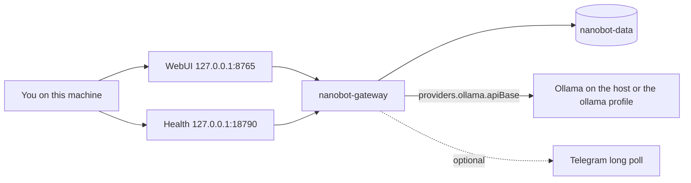

# Architecture

`nanobot-gateway` is the upstream image at commit `0dc8679edcc6061fbcdf3de13c7e16000e9d1b65`, started with `gateway`. `docker/entrypoint.sh` only checks that `config.json` is already on the volume, then execs upstream `entrypoint.sh`. That script drops to uid 1000 and, because `NANOBOT_DOCKER_BOOTSTRAP=1`, notices the existing file and does not rewrite it (`nanobot/cli/docker_bootstrap.py`).

The image directory `/home/nanobot/.nanobot` is owned by uid 1000. With every capability dropped except `CHOWN`, `SETGID`, and `SETUID`, root cannot write that directory. Bootstrap `chown`s it to `nanobot` (the same `CHOWN` capability the upstream entrypoint uses) and writes `config.json` as uid 1000.

`nanobot-cli` is the same image under profile `cli`. Its default command is `status`. Pass another nanobot command as arguments to `docker compose run`.

`ollama` is profile `ollama` and is not started by `make up`.

The data directory inside the container is `/home/nanobot/.nanobot` (`Dockerfile` `mkdir` and `ENV HOME=/home/nanobot`). The workspace path written into config is `/home/nanobot/.nanobot/workspace`.

## Why the rendered file sets the bind addresses

Upstream Docker bootstrap writes `gateway.host` and `channels.websocket.host` as `0.0.0.0`, plus a WebUI secret, and then stops touching the file. Because we pre-create `config.json`, we have to include those fields ourselves. Docker publishes them only on the host loopback. A process bound to `127.0.0.1` inside the container would not receive traffic forwarded to the container's eth0 (`docs/deployment.md` in the upstream tree: Docker port forwarding cannot reach `127.0.0.1` inside a container).

## Keys bootstrap writes

Every key below exists at `0dc8679edcc6061fbcdf3de13c7e16000e9d1b65`. Line numbers refer to that tree. id42-agent env names are not nanobot keys. They are copied into the fields in the last column.

| Written JSON | Upstream definition | id42-agent source |
|---|---|---|
| `agents.defaults.workspace` | `AgentDefaults.workspace`, `nanobot/config/schema.py:180` | fixed path inside the volume |
| `agents.defaults.modelPreset` | `AgentDefaults.model_preset`, `schema.py:181` | constant `primary` |
| `agents.defaults.timezone` | `AgentDefaults.timezone`, `schema.py:204` | `TZ` |
| `agents.defaults.timezoneMode` | `AgentDefaults.timezone_mode`, `schema.py:205` | constant `manual` |
| `providers.ollama` | `ProvidersConfig.ollama`, `schema.py:346` | constant |
| `providers.ollama.apiBase` | `ProviderConfig.api_base`, `schema.py:263` | `OLLAMA_BASE_URL` |
| `modelPresets` | `Config.model_presets`, `schema.py:509-512` | constant object |
| `modelPresets.primary.provider` | `ModelPresetConfig.provider`, `schema.py:160` | constant `ollama` |
| `modelPresets.primary.model` | `ModelPresetConfig.model`, `schema.py:159` | `OLLAMA_MODEL` |
| `modelPresets.primary.maxTokens` | `ModelPresetConfig.max_tokens`, `schema.py:162` | `4096`, as in upstream `docs/providers.md` Ollama example |
| `modelPresets.primary.contextWindowTokens` | `ModelPresetConfig.context_window_tokens`, `schema.py:163` | `32768`, same example |
| `gateway.host` | `GatewayConfig.host`, `schema.py:404` | `0.0.0.0` inside the container |
| `gateway.port` | `GatewayConfig.port`, `schema.py:405` | `18790` |
| `channels.websocket.enabled` | `WebSocketConfig.enabled`, `nanobot/channels/websocket/runtime.py:178` | `true` |
| `channels.websocket.host` | `WebSocketConfig.host`, `websocket/runtime.py:179` | `0.0.0.0` inside the container |
| `channels.websocket.port` | `WebSocketConfig.port`, `websocket/runtime.py:180` | `8765` |
| `channels.websocket.tokenIssueSecret` | `WebSocketConfig.token_issue_secret`, `websocket/runtime.py:186` | `NANOBOT_WEB_TOKEN` |
| `channels.websocket.websocketRequiresToken` | `WebSocketConfig.websocket_requires_token`, `websocket/runtime.py:189` | `true` |
| `channels.telegram.enabled` | `TelegramConfig.enabled`, `nanobot/channels/telegram/runtime.py:453` | only if `TELEGRAM_ENABLED=true` |
| `channels.telegram.token` | `TelegramConfig.token`, `telegram/runtime.py:454` | `TELEGRAM_BOT_TOKEN` |
| `channels.telegram.mode` | `TelegramConfig.mode`, `telegram/runtime.py:455` | `polling` |
| `channels.telegram.allowFrom` | `TelegramConfig.allow_from`, `telegram/runtime.py:456` | `TELEGRAM_ALLOWED_USERS` |
| `tools.restrictToWorkspace` | `ToolsConfig.restrict_to_workspace`, `schema.py:438` | `true` |
| `tools.exec.enable` | `ExecToolConfig.enable`, `nanobot/agent/tools/shell_config.py:11` | `false` |

`channels` accepts channel objects as extra fields (`ChannelsConfig` `extra="allow"`, `schema.py:48`). Camel case is the on-disk form (`nanobot/config_base.py` `alias_generator=to_camel`). Ollama's registry default base is `http://localhost:11434/v1` (`nanobot/providers/registry.py`, provider `ollama`).

Env vars passed through from upstream, not invented here:

| Variable | Where it is read |
|---|---|
| `NANOBOT_DOCKER_BOOTSTRAP` | `entrypoint.sh` (gateway command runs `nanobot.cli.docker_bootstrap` when this is `1`) |
| `NANOBOT_WEB_TOKEN` | `docker_bootstrap.py` when that bootstrap creates the file. We also copy it into `tokenIssueSecret` because the file already exists by then |
| `NANOBOT_CHANNELS` | Docker build arg, `Dockerfile` (default `whatsapp`) |

Not set, because they are not part of this pin's Compose path: `NANOBOT_API_KEY`, port `8900`, command `serve`.

## Workspace seed

nanobot reads `AGENTS.md`, `SOUL.md`, and `USER.md` from the workspace (`ContextBuilder.BOOTSTRAP_FILES` in `nanobot/agent/context.py`). It creates missing templates, including a `skills/` directory, without overwriting files that exist (`sync_workspace_templates` in `nanobot/utils/helpers.py`). A skill is a subdirectory of `workspace/skills` containing `SKILL.md` (`SkillsLoader` in `nanobot/agent/skills.py`).

The seed in this repository is copied only while `config.json` is created, and only into paths that are still absent. Built-in skills stay inside the image.

## Health

`GET /health` on `gateway.host`:`gateway.port` returns JSON. HTTP 200 with `ready: true` means the process is up and the websocket channel is running (`nanobot/cli/gateway_runtime.py`). Compose runs `curl --fail` against `http://127.0.0.1:18790/health` inside the container. `curl` is installed by the upstream Dockerfile.

## ID42 Work

The agent runtime is replaceable. Policy over what it may execute is planned as an MCP server shipped with ID42 Work, attached later at `tools.mcpServers` (`MCPServerConfig` in `schema.py`). This phase leaves that map empty. See [roadmap.md](roadmap.md).
